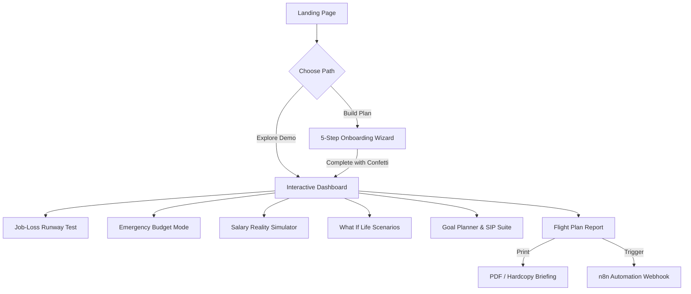

# FIRSTSALARY OS — DETAILED PRODUCT & TECHNICAL SPECIFICATION

## 1. Problem Statement & Background

**Official Problem Statement:** *“Help new employees plan savings, SIPs and investment allocation.”*

### Context
When young professionals in India receive their first salary, they face a unique set of challenges:
1. **The CTC vs In-Hand Illusion:** High yearly CTC offers often mask significantly lower take-home pay after standard EPF deductions, gratuity, and TDS withholding.
2. **Premature Speculation:** Without an emergency buffer, many young earners jump directly into crypto, F&O trading, or locked equity schemes. When medical emergencies or rent deposits arise, they are forced to liquidate at a loss or take 36%+ APR credit card debt.
3. **Absence of Survival Planning:** Traditional calculators assume steady, perpetual income. They fail to prepare earners for startup layoffs, probation cuts, or metropolitan rent hikes.

---

## 2. Target Users & Personas

- **Persona A: The Fresh Graduate (Aarav, 22)**
  - First software engineering job in Bengaluru. Earning ₹65,000/mo.
  - Paying ₹18,000 rent for a shared flat. Confused about whether to start a ₹15,000 SIP or build emergency savings first.
- **Persona B: The Career Switcher (Priya, 24)**
  - Moving to a high-cost tier-1 metro. Needs to simulate what a ₹12,000 rent increase does to her monthly savings rate and goal timelines.
- **Persona C: The Startup Employee (Rohan, 23)**
  - Concerned about startup runway and layoffs. Needs to know how many days his bank balance will cover rent and groceries if his company downsizes.

---

## 3. Core Features & Capabilities

| Feature | Purpose & Distinction |
|---|---|
| **Income & Outflow Planning** | Separates essential needs from discretionary lifestyle wants and existing EMIs/family support. |
| **Job-Loss Survival Calculator** | Simulates zero-income runway in exact months and days against essential living costs. Incorporates one-time shocks. |
| **Emergency Budget Mode** | Interactive defensive simulator that tests severe salary reduction (0% to 50%) and calculates exact days gained by pausing lifestyle subscriptions. |
| **Salary Reality Lab** | Live interactive sliders for salary appraisals, rent increases, and higher SIPs with instant before-and-after deltas. |
| **“What If Life Happens?”** | 5 real-world crisis presets (Layoffs, Pay cuts, Hospitalization, Metro relocation) with tailored action roadmaps. |
| **Transparent Suggested Allocation** | Dynamic allocation engine that respects cash flow. Never manufactures unaffordable investments during a deficit. |
| **Goal Planner & Affordability Radar** | Tracks milestones and flags conflicts when total goal requirements exceed monthly surplus. |
| **SIP Compounding Calculator** | Monthly end-of-month compounding model with benchmark chips (8%, 12%, 15%) and progression tables. |
| **First-Salary Flight Plan** | Printable executive summary report with 4 prioritized directives and one-click n8n webhook dispatch. |
| **Risk Profile Questionnaire** | 6 beginner-friendly questions determining conservative, moderate, or growth orientation. |

---

## 4. User Journey Flow

---

## 5. Technical Architecture

- **State Management:** Pure React state with local storage caching and reactive props.
- **Financial Calculation Contracts:** Pure, testable functions isolated in `src/lib/calculations.ts` with zero side effects.
- **Database Layer:** Supabase client with Postgres RLS; gracefully operates offline via LocalStorage fallback.
- **Automation Dispatcher:** Modular client service in `src/lib/automation.ts` with minimal event payload validation and in-app logs.

---

## 6. Known Limitations & MVP Scope Boundaries

1. **No Live Stock/Brokerage API:** FirstSalary OS intentionally avoids live market trading or broker integrations in the MVP to minimize regulatory and security overhead.
2. **No Bank Account Scraping / Screen Scraping:** FirstSalary OS intentionally does not collect NetBanking credentials or OTPs, preserving privacy and eliminating credential theft risks.
3. **Hypothetical Compounding:** Projections assume uniform compounding rates and do not simulate day-to-day equity market drawdowns or sequence-of-returns risk.
